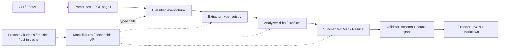

# Structured LLM Workflow · AI Document Intelligence

[](https://github.com/FouHe0720/structured-llm-workflow/actions/workflows/ci.yml)
[](LICENSE)

把招聘 JD、论文摘要、会议纪要和技术报告转换为带原文证据的 JSON / Markdown 报告。
这是 **固定 Workflow**：步骤与边界由代码决定，模型不选择工具、不执行文档中的指令。
默认免费离线 Mock，无 GPU、模型下载或 API Key 前置条件。

**English overview:** An offline-first, typed document intelligence workflow built with
Pydantic, FastAPI, httpx and pypdf. It combines versioned prompts, bounded JSON repair,
extractive source evidence, hierarchical Map/Reduce, usage accounting and reproducible
fault evaluation. Mock results demonstrate workflow behavior, not real LLM quality.

## 实际解决的问题

自由文本难以被下游系统稳定消费；有效 JSON 也可能包含编造内容。
本项目同时检查 **结构是否合法** 与 **输出是否有原文连续 span 支持**，保留缺失字段和冲突，
让使用者可以从结论回到段落/页码。它不判断原文真假，也不承诺解决语义层面的 Hallucination。

- 五种文档类型及独立 Pydantic Schema；未提供的作者、年限、指标保持 `null` / `[]`。
- 纯文本、UTF-8 `.txt` / `.md`、文本型 `.pdf`；CLI、JSON API、文件上传共用同一 Pipeline。
- 原生 JSON Schema 优先；可显式配置 JSON mode / text，并做严格校验与有限修复。
- 覆盖全文的 Map → Reduce；列表去重、标量冲突置空，保留所有冲突候选及证据。
- 每次调用耗时、真实/估算 tokens、调用上限、本机可选缓存与来源明确的可编辑价格表。
- 40 条固定 gold 样例、故障注入、60 个测试、CI、实跑过的非 root Docker 镜像。

## 架构



源文件分层与具体边界见 [ARCHITECTURE](docs/ARCHITECTURE.md)、
取舍见 [TECH_DECISIONS](docs/TECH_DECISIONS.md)。没有 Agent 框架、数据库服务或复杂容器编排。

## Quick Start（WSL / Linux，免费 Mock）

需要 Python 3.10+，推荐已有 `uv` 的环境。在本仓库根目录执行：

```bash
make install
make demo
make check
make eval
```

`make install` 优先 `uv sync --extra dev --frozen`，只使用项目 `.venv`。
系统没有 uv 且具备 Python venv/pip 时会使用以下等价方式：

```bash
python3 -m venv .venv
.venv/bin/python -m pip install -e '.[dev]'
```

如果系统缺少 `ensurepip`，请使用已安装的 uv；本次 WSL 环境实际采用了该路径，无系统范围安装。
首次安装依赖需要网络；安装后默认分析与评测均离线运行。
依赖范围在 `pyproject.toml`，跨 Python 版本锁定在 `uv.lock`；Docker 使用带 hash 的 `requirements.lock`。

单文件演示：

```bash
.venv/bin/python -m app.cli analyze examples/jd.txt --output outputs/jd.json
.venv/bin/python -m app.cli analyze examples/sample.pdf --output outputs/pdf.json
.venv/bin/python -m app.cli analyze examples/long_50000.txt --output outputs/long.json
```

每次同时生成 `.json` 和 `.md`。`examples/jd.txt` 的真实 Mock 提取结果：

```json
{
  "position": "Python Workflow Engineer",
  "skills": ["Python", "SQL", "Pydantic"],
  "experience": null,
  "responsibilities": ["Build document pipelines", "Review evidence"],
  "summary": "Build reliable document analysis workflows."
}
```

完整输出含 `type`、`metadata`、`extracted`、`summary`、`risks_or_highlights`、
`evidence`、`conflicts`、`model_info`、`timings`、`usage`、`validation_status`、`warnings`。
evidence 的 `start:end` 是解析后文本的 Unicode 字符偏移（end exclusive），PDF 额外保留 1-based 页码；
不是原 PDF 的字节位置或页面坐标。相同 quote 重复出现时指向第一次出现的位置。

## API

```bash
make serve
```

另开终端：

```bash
curl -s http://127.0.0.1:8000/health
curl -s http://127.0.0.1:8000/v1/analyze \
  -H 'Content-Type: application/json' \
  -d '{"text":"Job Description\nPosition: Reviewer\nSkills: Python"}'
curl -s http://127.0.0.1:8000/v1/analyze/file -F 'file=@examples/sample.pdf'
```

OpenAPI UI：`http://127.0.0.1:8000/docs`。`/health` 是存活检查，不探测外部模型。
默认文件上限 2 MiB、解析文本 200,000 字符、PDF 50 页；ASGI 请求体另允许 64 KiB 格式开销，
路由继续检查实际文本/文件大小。字符数不等于 token 数。纯文本按 UTF-8 编码；扫描 PDF 不做 OCR。
API 默认仅监听本机，没有认证和用户级限流。

## 真实 LLM 配置（可选）

复制 `.env.example` 为本地 `.env`，不要提交密钥。使用自己的兼容 endpoint 和 model：

```dotenv
WORKFLOW_PROVIDER=openai
WORKFLOW_MODEL=your-provider-model
WORKFLOW_BASE_URL=https://your-provider.example/v1
WORKFLOW_API_KEY=
WORKFLOW_RESPONSE_MODE=json_schema
```

这是占位地址；实际配置由使用者提供，自建无鉴权服务可留空 Key。
adapter 使用 `POST {BASE_URL}/chat/completions`，适用于兼容该协议的服务。
若服务不支持 JSON Schema，显式设 `json_object`；再不支持时设 `text`。
不会自动把 401、429、超时或任意 400 当成能力降级。所有模式都经过相同的 Pydantic 与原文支持校验。
协议依据：[OpenAI Structured Outputs](https://developers.openai.com/api/docs/guides/structured-outputs?api-mode=chat)。

```bash
.venv/bin/python -m scripts.smoke_real
.venv/bin/python -m eval.run_eval --output outputs/real-eval
```

这些命令会连接你配置的服务，可能产生费用；本次交付 **未运行外部真实模型**。
已验证 httpx MockTransport 和真实 localhost fixture HTTP 服务；这只证明协议路径。
真实模型评测禁用所有 Mock 故障注入，保留同一组 gold。

## 长文、tokens 与费用治理

- 默认源 chunk 预算 `WORKFLOW_CHUNK_TOKENS=1200`，以 UTF-8 bytes 作为保守代理估算。
  每个字符都会进入某个 chunk；不偷偷丢弃尾部。超长单行拆分会明确 warning，跨 chunk 关系可能丢失。
- `WORKFLOW_CONTEXT_TOKENS=8192` 检查 prompt + schema + 源文本 + 2048 输出预留；
  这是估算，第三方 tokenizer 可能不同。超预算直接返回可诊断错误。
- 每个 chunk 走分类、提取、分析和摘要；长文再做层次 Reduce。摘要最多三个原文 span、合计 192 估算 tokens。
  默认 50K 样例为 43 chunks / 173 次 Mock 调用，**不是性能 benchmark**。
- 默认 `WORKFLOW_MAX_CALLS=512`，JSON 修复默认最多 1 次、硬上限 2 次，超时不自动重试。
  字符限制、上下文限制和调用限制独立生效；字符数允许的文档也可能达到调用上限而失败。
- `usage.records` 逐次记录成功/失败、耗时与 token 来源；Provider 未返回 usage 时明确记为 `estimated`。
- `config/prices.json` 默认空，所以 cost 为 `null`。逐模型填写 `as_of`、`source`、
  `input_usd_per_million_tokens`、`output_usd_per_million_tokens` 后才计算价格；估算 usage 对应的成本也是估算。
  不提供实时价格同步或账单对账。
- 缓存默认关闭，打开 `WORKFLOW_CACHE_ENABLED=true` 才写本机 `.cache/workflow`。
  key 包含整个文档 hash、chunk 内容、模型/endpoint、prompt 版本与正文、schema 和输出预算。
  已验证输出才缓存；缓存命中不计作新模型调用。没有 TTL，敏感文档应保持关闭。

## 已执行的验证

2026-10-21，WSL Linux / Python 3.12.15 / Docker 29.8.2：

| 检查 | 实际结果 |
|---|---|
| `pytest -q` | **60 passed**；1 条 Starlette/httpx 上游弃用提示 |
| Ruff lint / format | 全部通过 |
| Quick Start / CLI | JD、PDF、50K 字符 JSON + Markdown 实跑成功 |
| API | 本机 HTTP health / analyze 返回 200；上传、超时和边界由测试覆盖 |
| Package | sdist / wheel 构建成功；9 个 prompt 与 Mock fixture 均已打包 |
| Docker | 镜像构建成功；容器 UID 10001，CLI、health / analyze 实跑成功 |
| 公共内容扫描 | 通过；运行产物、缓存、`.env` 与 venv 被排除 |
| GitHub Actions | [首发 CI](https://github.com/FouHe0720/structured-llm-workflow/actions/runs/39546943233) 通过；Python 3.10 / 3.12 各 60 passed，Docker job 通过 |
| 真实外部模型 | 未执行，无 API Key 前置要求 |

完整本机记录见 [VERIFICATION](docs/VERIFICATION.md)；GitHub Actions 结果见顶部动态 badge / Actions 页面。

40 条 Mock + 故障注入评测的已提交结果见 [JSON](eval/results/mock/results.json)、
[CSV](eval/results/mock/results.csv)、[Markdown](eval/results/mock/SUMMARY.md)。
本次快照：合法报告 37/40（92.5%），gold 字段 180/192（93.75%），
最终报告无原文 span 支持断言 0/141；文档 P50/P95 约 3.08/3.83 ms。
这些仅是 **Mock 流程指标**，不能解释为真实模型质量或推理性能。
三条预期错误被拒绝；另有一条刻意错分类被 evaluator 检出，39/40 满足预期结果。
启用 `--require-expectations` 会因该故意失败样例返回非零。
指标分母、故障和 gold 来源见 [eval/README](eval/README.md)。

## Docker

```bash
docker build -t structured-llm-workflow:local .
docker run --rm -p 127.0.0.1:8000:8000 structured-llm-workflow:local
```

容器 CLI 示例（输出位于临时容器，不会保存回宿主机）：

```bash
docker run --rm structured-llm-workflow:local \
  python -m app.cli analyze examples/jd.txt --output /tmp/report.json
```

## 设计取舍与局限

1. **可审计优先**：摘要和风险都是抽取式，允许少说、拒绝无证据输出；自然改写能力受限。
2. **结构与语义分开评测**：有源文 span 不代表字段语义正确，更不代表源文真实；错分类仍可能符合 schema。
3. **Mock 有明确能力边界**：基于 fixture 标题/字段标签规则，不是通用自然语言理解器，不能拿它的分数证明 LLM 效果。
4. **PDF 是文本提取**：无 OCR、版面重建、表格结构恢复或恶意 PDF 资源沙箱；混合空白/扫描页会警告。
5. **本机工具定位**：无用户系统、认证、队列和公网限流。第三方 API 的能力、tokenizer、价格与模型质量需单独验证。
6. **小型自建 gold 集**：固定标注与文档一起编写，未获独立人工复核；长距离关系、精确逻辑冲突和对抗性语义尚无全面保证。

可继续扩展：经独立复核的真实公开语料、按 provider 适配 tokenizer、PDF 解析进程隔离、
带 provenance 的人工审阅界面、严格定义的语义支持评测。当前代码不宣称已经实现这些能力。

## 阅读与求职展示

- [DEMO](docs/DEMO.md)：逐条可复制的展示步骤。
- [INTERVIEW_GUIDE](docs/INTERVIEW_GUIDE.md)：核心源码阅读顺序、10 个真实实现追问。
- [RESUME_BULLETS](docs/RESUME_BULLETS.md)：不编造模型准确率或性能提升的简历表述。
- [IMPLEMENTATION_PLAN](docs/IMPLEMENTATION_PLAN.md)：V0 → V3 的实际交付阶段。

## License

[MIT](LICENSE)。仓库代码、fixture、示例文本和自动生成的 PDF 均为本项目自建；
不包含私人材料、招聘方真实 JD、真实论文全文或第三方模型权重。
